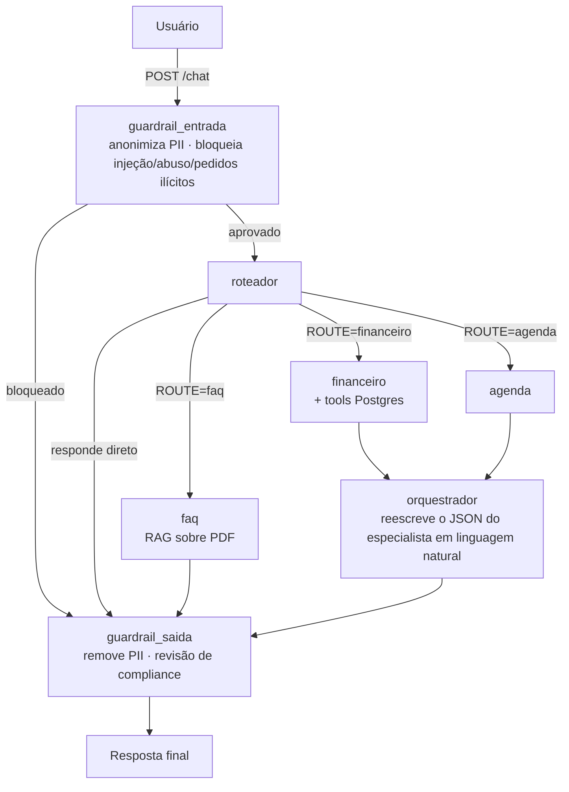

# AssessorIA

Assessor virtual de finanças pessoais e agenda, construído com FastAPI e um sistema multiagente em LangChain. Recebe mensagens em linguagem natural, decide qual especialista deve responder, opera um banco de dados real por trás e devolve uma resposta em português — com guardrails de segurança e compliance em toda a entrada e saída.


## Visão geral

- **Financeiro**: registra, consulta, atualiza e resume transações (receitas/despesas) num Postgres real.
- **Agenda**: interpreta pedidos de compromissos e eventos (hoje sem persistência própria — ver [Limitações](#limitações-conhecidas)).
- **FAQ**: responde sobre as regras do próprio AssessorIA a partir de um PDF, via RAG (FAISS + embeddings do Gemini).
- **Memória de longo prazo**: cada sessão de conversa vira um resumo ao ser encerrada; sessões futuras conseguem recuperar esse resumo por meio de uma tool dedicada.
- **Guardrails**: anonimização de PII, bloqueio de prompt injection/abuso na entrada, e revisão de compliance financeiro (CVM/ANBIMA) na saída.

## Arquitetura



Roteador, financeiro e agenda têm acesso a uma tool de memória (`buscar_historico`) que consulta resumos de conversas **anteriores já encerradas** do mesmo `session_id` — não o histórico da conversa atual. O FAQ fica de fora de propósito: ele responde sobre regras do sistema, não sobre o que o usuário disse antes.

Cada agente é montado com `langchain.agents.create_agent`; os especialistas financeiro e agenda usam Gemini como modelo principal, com fallback automático para um modelo da Groq caso o Gemini falhe. Roteador, orquestrador e FAQ usam um modelo Groq mais rápido, sem fallback.

## Stack

| Camada | Tecnologia |
|---|---|
| API | FastAPI + Uvicorn |
| Orquestração de agentes | LangChain (`create_agent`) |
| LLMs | Google Gemini (principal) · Groq (roteador/orquestrador e fallback) |
| Banco transacional | PostgreSQL (transações, categorias) |
| Memória de sessão | MongoDB (histórico de mensagens e resumos) |
| RAG do FAQ | FAISS + `GoogleGenerativeAIEmbeddings` |
| Frontend | HTML/CSS/JS estático, servido pelo próprio FastAPI |

## Estrutura do projeto

```
migracao_fastAPI/
├── app/
│   ├── main.py           # instancia o FastAPI, CORS, rotas e serve o frontend
│   ├── graph.py           # monta os agentes e o fluxo de uma pergunta (executar_fluxo_assessor)
│   ├── guardrail.py       # anonimização de PII, guardrails de entrada e saída
│   ├── memory.py          # ciclo de vida da sessão no MongoDB (iniciar/salvar/encerrar/recuperar)
│   ├── llms.py            # instâncias dos modelos (Gemini, Groq) e fallback
│   ├── prompts.py         # prompts e few-shots de cada agente
│   ├── schemas.py         # contratos Pydantic da API
│   ├── routes/            # chat.py (POST /chat) e sessions.py (ciclo de vida da sessão)
│   └── tools/             # financeiro.py (Postgres), faq.py (RAG), memoria.py (busca histórico)
├── frontend/               # chat estático (HTML/CSS/JS puro, sem build step)
├── data/                   # PDF usado pela tool de FAQ
├── docs/                   # material de referência/estudo da migração
├── schema.sql              # schema do Postgres (tabelas + seeds)
├── requirements.txt
└── .env.example
```

## Como rodar

### Pré-requisitos
- Python 3.11+
- Uma instância PostgreSQL acessível (ex.: [Aiven](https://aiven.io), Supabase, ou local)
- Uma instância MongoDB acessível (local ou Atlas)
- Chaves de API: [Gemini](https://aistudio.google.com/) e [Groq](https://console.groq.com/)

### Passo a passo

```bash
git clone https://github.com/dvarakaki/financial-assistant-ai.git
cd financial-assistant-ai

python -m venv .venv
.venv\Scripts\activate       # Windows
# source .venv/bin/activate  # Linux/Mac

pip install -r requirements.txt
```

Copie `.env.example` para `.env` e preencha com suas credenciais:

```bash
cp .env.example .env
```

Crie o schema no Postgres:

```bash
psql "$DATABASE_URL" -f schema.sql
```

(ou rode o conteúdo de `schema.sql` pelo cliente de sua preferência — pgAdmin, DBeaver, etc.)

Suba a API:

```bash
python -m uvicorn app.main:app --reload
```

O chat abre em `http://127.0.0.1:8000/`, e a documentação interativa (Swagger) em `http://127.0.0.1:8000/docs`.

## Endpoints

| Método | Rota | Descrição |
|---|---|---|
| `POST` | `/chat` | Envia uma pergunta (`session_id` + `pergunta`) e recebe a resposta do assessor |
| `POST` | `/sessions/{session_id}/iniciar` | Abre uma sessão explicitamente (opcional — `/chat` já abre sozinho) |
| `POST` | `/sessions/{session_id}/encerrar` | Encerra a sessão: gera o resumo via LLM e grava no Mongo |
| `GET` | `/health` | Status da API e checagem de variáveis de ambiente obrigatórias |

## Limitações conhecidas

- **`session_id` identifica a conversa, não a pessoa**: o frontend sorteia um UUID novo a cada "nova conversa", então a memória de longo prazo só funciona enquanto o mesmo id for reutilizado entre sessões (ex.: via um `user_id` fixo, ainda não implementado no frontend).
- **Fechar a aba não gera resumo**: só o botão "nova conversa" chama `POST /sessions/{id}/encerrar`. Sem isso, a conversa fica salva mas invisível para a memória de longo prazo.
- **Agenda ainda não persiste nada**: o especialista de agenda interpreta o pedido, mas não há tools de banco de dados para eventos ainda.

## Licença

[MIT](LICENSE)
