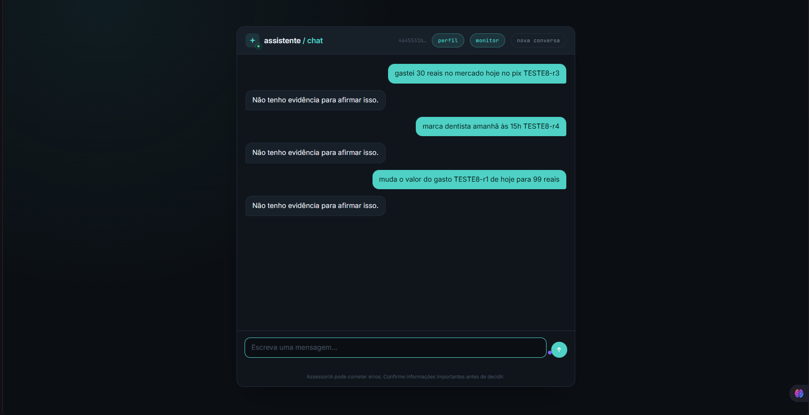
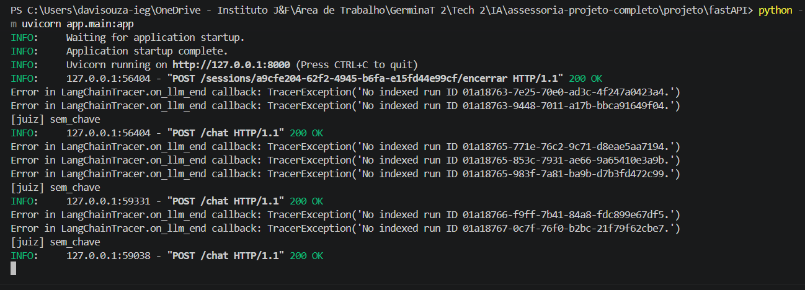
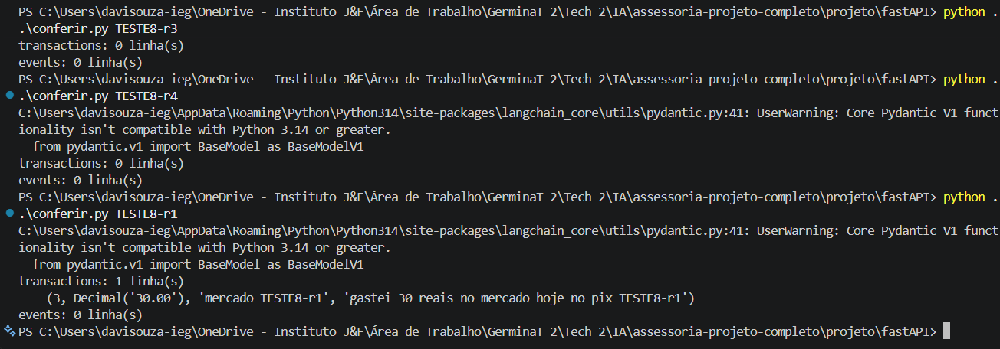
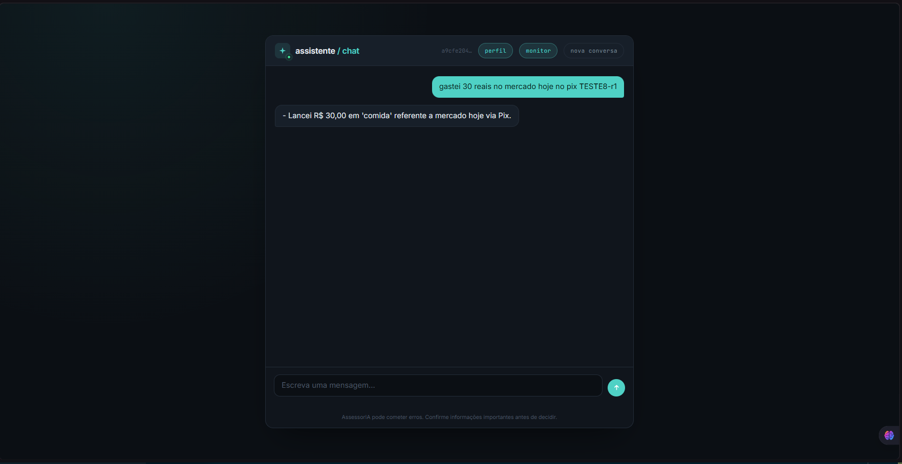
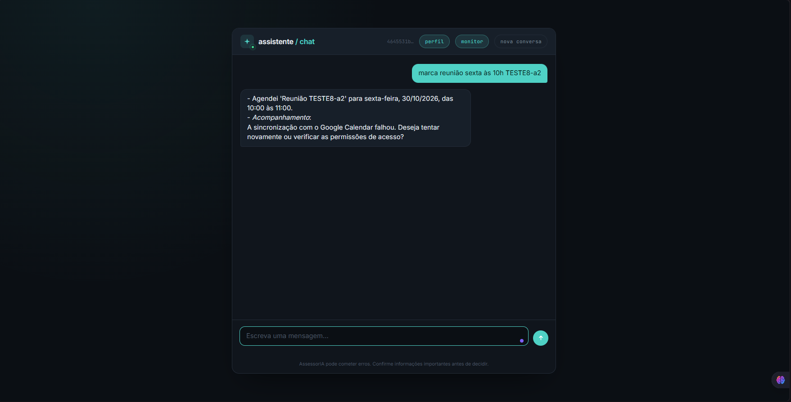
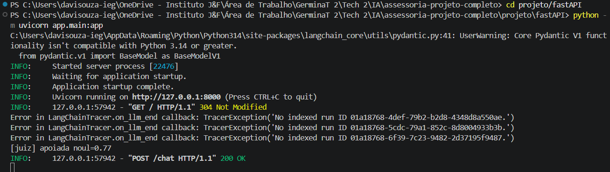
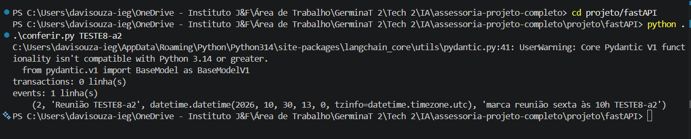

# DECISÃO TÉCNICA - O juiz e a escrita (Etapa 8)

## O problema

Na Etapa 7 o juiz passou a falar por último, mas as três tools que alteram o Postgres davam `commit()` dentro delas, antes do veredito. Um turno recusado mostrava "Não tenho evidência para afirmar isso." e a linha continuava em `transactions` ou `events`.

Invariante desta etapa: **se o turno for recusado, nenhuma escrita desse turno permanece** em `add_transaction`, `update_transaction` e `add_event`.

## 1. A decisão tomada: uma transação por turno

A fronteira que autoriza a escrita passou a ser o **veredito do juiz em `executar_fluxo_assessor`** (`app/graph.py`). Todas as escritas de um turno acontecem numa única transação do Postgres, aberta e fechada pelo fluxo, não pelas tools.

- `TransacaoTurno` (`app/infra/db.py`) guarda a conexão do turno. Ela chega às tools pelo `RunnableConfig`, mesmo caminho do `user_id` em `app/tools/perfil.py`. O modelo não vê nem preenche esse valor: o schema que vai para o LLM continua igual.
- As tools de escrita gravam com `transacao_do_turno(config).escrita()` e **não dão mais `commit()`**. O `INSERT ... RETURNING id` acontece de verdade, então o retorno da tool (e a evidência do juiz) traz o `id` real, como antes.
- Depois do juiz, o `graph.py` decide: resposta aprovada → `transacao.confirmar()` (commit). Qualquer outro caso → nada é confirmado, o `finally` fecha a conexão e o Postgres descarta o que foi gravado.
- Cada escrita roda num `SAVEPOINT`. Ele faz o papel do `rollback()` que cada tool tinha: um erro de SQL desfaz só aquela escrita, não as anteriores do mesmo turno.
- Um `threading.Lock` por turno serializa as escritas. O `ToolNode` executa em paralelo (threads) as tool calls de uma mesma resposta, por exemplo dois lançamentos numa frase só, e cursor e `SAVEPOINT` não podem se misturar na mesma conexão.
- A conexão só abre na primeira escrita. Turno de FAQ, saudação ou consulta não paga conexão a mais, e um banco fora do ar continua virando o erro amigável da tool.

**Por que cabe neste projeto.** Não existe StateGraph: o turno já é uma função Python linear que termina no juiz. Colocar a decisão no fim dessa função é o lugar natural, e nenhum agente, rota ou API muda. A garantia vem do próprio Postgres: o que não teve commit não existe para ninguém, nem para outra conexão, nem depois de uma queda do processo.

**Garantia nas três tools.** `add_transaction`, `update_transaction` e `add_event` passam pelo mesmo `escrita()`, e nenhuma delas tem `commit()`. O único `commit()` de escrita do turno está em `TransacaoTurno.confirmar()`, chamado somente após aprovação.

### Fluxo antes

```
modelo escolhe tool → tool grava + COMMIT + fecha conexão → orquestrador → guardrail_saida → juiz recusa → chat mostra frase segura
                                   ↑ a linha já é permanente aqui
```

### Fluxo depois

```
modelo escolhe tool → tool grava (SAVEPOINT, sem commit) → orquestrador → guardrail_saida → juiz
                                                                                         ├─ aprovado → COMMIT → salva no Mongo → chat
                                                                                         └─ recusado / sem resposta → (sem commit) → salva no Mongo → chat
finally: fecha a conexão → o que não foi confirmado é descartado pelo Postgres
```

## 2. As decisões que não tomamos

**Interceptar (julgar a ação antes da tool).**
- *Como funcionaria:* um passo antes de cada tool de escrita mandaria a ação proposta ao JEV.
- *Vantagem real:* nada é gravado sem um veredito prévio.
- *Custo real:* uma chamada a mais ao juiz por escrita (latência e custo de API). Além disso, **não garante a invariante sozinha**: a frase final ainda passa pelo juiz depois e pode ser recusada com a escrita já aprovada e gravada.
- *Por que ficou de fora:* exigiria combinar com outra família e custaria mais do que a transação.

**Adiar (no Postgres).**
- *Como funcionaria:* a tool guardaria a intenção (SQL e parâmetros) e o fluxo executaria depois do veredito.
- *Vantagem real:* nenhum comando chega ao banco antes da aprovação.
- *Custo real:* a tool não teria o `id` real para devolver. `"escrita":{"id":...}` e a evidência do juiz passariam a ser um valor pendente ou inventado. O `update_transaction`, que localiza o registro por texto e data, teria de reproduzir essa busca fora do banco.
- *Por que ficou de fora:* reimplementa em Python o que a transação do Postgres já faz, e piora a evidência do juiz.

**Compensar.**
- *Como funcionaria:* manter o `commit()` nas tools e, na recusa, rodar a ação inversa (`DELETE` do id inserido, ou `UPDATE` de volta aos valores antigos, que a tool teria de guardar antes de alterar).
- *Vantagem real:* as tools ficam quase como estavam e a conexão não fica aberta esperando o juiz.
- *Custo real:* entre o commit e a compensação, a linha é visível para outros turnos. A compensação é um segundo efeito que também pode falhar. Se o processo cair entre os dois passos, a escrita fica para sempre, que é o furo original.
- *Por que ficou de fora:* não sustenta a invariante em caso de queda, e exige snapshot do registro no `update_transaction`.

Mudar só o prompt ou desligar as tools de escrita não entram: não são garantia, e o enunciado os exclui.

## 3. Efeito nas métricas do SRE (monitor da Etapa 6)

| Métrica | Decisão tomada (transação por turno) | Alternativa: Interceptar |
|---|---|---|
| Latência do turno / p95 (SLO 8 s) | Praticamente igual. Não há chamada de modelo a mais. Antes cada tool abria a própria conexão; agora há no máximo uma por turno, aberta na primeira escrita. O único caso que piora é concorrência na **mesma** linha: um `UPDATE` segura o lock da linha até o fim do turno (orquestrador + compliance + juiz, alguns segundos), e outro turno que altere a mesma linha espera. | Sobe: mais uma ida ao JEV (HTTP, até 30 s de timeout) por escrita, somada à chamada que já existe no fim. Pressiona o p95 em todo turno que escreve. |
| Taxa de erro (SLO 5%) | Recusa **não** é erro: o turno termina com a frase segura, sem exceção, e o status é `ok`. Surge uma fonte nova de erro, rara: falha no `commit()` vira exceção, status `erro`. | Cada chamada extra ao JEV é uma fonte nova de falha, tratada como recusa ou como erro. |
| Status `ok` / `erro` / `bloqueado` | Mesmos três status. `bloqueado` continua sendo só o guardrail de entrada, que retorna antes de qualquer escrita. | Mesmos três status. |
| Tokens e custo | Sem mudança: o monitor só conta chamadas de modelo, e nenhuma foi acrescentada. | O JEV não passa pelo coletor de LLM, então não aparece em tokens. O custo real da API TypeSafe aumenta. |

Mecanismo resumido: a decisão troca "uma conexão por tool, com commit imediato" por "uma conexão por turno, aberta à espera do veredito". O custo dela é uma transação aberta por alguns segundos, não uma chamada a mais.

## 4. As outras decisões

**`add_google_event`: fora do escopo.** O efeito é numa API externa, que não participa de uma transação do Postgres. Para incluí-lo teríamos de adiar a chamada para depois do commit (a tool passaria a devolver "pendente", o que muda o que o modelo e o juiz veem, além do prompt da agenda) ou compensar com um `DELETE` na API do Google (o evento aparece por alguns segundos e pode ficar se o `DELETE` falhar). Mantivemos a mudança na fronteira do Postgres, que é a invariante pedida. **Consequência assumida:** num turno de agenda recusado, o evento some de `events` mas pode continuar no Google Agenda.

**`salvar_mensagem`: mantida como estava.** Ela já roda depois do juiz e grava no Mongo a frase que o usuário viu. O histórico deve refletir a conversa real, inclusive a recusa, e o Mongo não faz parte da invariante (`transactions` e `events`).

**Juiz sem resposta: falha fechada.** `julgar()` já devolve `FRASE_SEGURA` em timeout, erro HTTP, exceção ou ausência de `TYPESAFE_API_KEY`. O `graph.py` só confirma quando a resposta é diferente dela. Nesses casos o usuário vê "Não tenho evidência para afirmar isso." e o banco fica como antes do turno. Sem a chave, portanto, nenhuma escrita permanece. Resposta vazia não foi julgada e também não confirma.

**Se o processo cair entre dois passos:**
- Antes do commit, a conexão cai e o Postgres desfaz a transação. A invariante se mantém.
- Depois do commit e antes de `salvar_mensagem`, a escrita aprovada permanece, mas a conversa no Mongo fica sem esse turno e o usuário recebe erro. Ele pode repetir o pedido e gerar uma duplicata (item seguinte).
- Se o próprio `commit()` falhar, a exceção vira status `erro` e nada permanece.

**Repetição do mesmo pedido:**
- Após uma recusa, nada ficou, e a nova tentativa é independente.
- Após uma aprovação, repetir cria um segundo registro, como antes desta etapa. Chave de idempotência ficou fora do escopo.
- Observação: o `BIGSERIAL` consome o número mesmo quando a transação é descartada, então os ids podem ter "buracos". Isso é esperado e inofensivo.

### Evidência

Executamos os testes com o servidor real (Postgres, Mongo e Qdrant conectados), um marcador único por tentativa (`TESTE8-<sufixo>`) escrito na própria mensagem. Para cada tentativa, consultamos o Postgres com um script auxiliar local (fora do repositório) que faz `SELECT ... WHERE source_text ILIKE '%<marcador>%'` em `transactions` e `events`, e copiamos a linha `[juiz]` do terminal do servidor.

- **Recusa:** servidor iniciado com `TYPESAFE_API_KEY` comentada no `.env`. O juiz cai em `sem_chave`, devolve a frase segura e o turno é recusado de forma reproduzível.
- **Aprovação:** servidor iniciado com a chave configurada.

| # | Tool | Cenário | Marcador | Log `[juiz]` | Chat | Banco depois |
|---|---|---|---|---|---|---|
| 1 | add_transaction | recusado | `TESTE8-r3` | `sem_chave` | "Não tenho evidência para afirmar isso." | `transactions: 0 linha(s)` |
| 2 | add_event | recusado | `TESTE8-r4` | `sem_chave` | "Não tenho evidência para afirmar isso." | `events: 0 linha(s)` |
| 3 | update_transaction | recusado (99 sobre linha existente) | `TESTE8-r1` | `sem_chave` | "Não tenho evidência para afirmar isso." | linha id 3 **continua com 30.00** |
| 4 | add_transaction | aprovado | `TESTE8-r1` | `apoiada noul=0.92` | "Lancei R$ 30,00 em 'comida' referente a mercado hoje via Pix." | **1 linha**: `(3, 30.00, 'mercado TESTE8-r1')` |
| 5 | add_event | aprovado | `TESTE8-a2` | `apoiada noul=0.77` | "Agendei 'Reunião TESTE8-a2' para sexta-feira, 30/10/2026, das 10:00 às 11:00." | **1 linha**: `(2, 'Reunião TESTE8-a2', 2026-10-30 13:00 UTC)` |
| 6 | update_transaction | aprovado | — | — | — | **não executado nesta rodada** |

O caso 6 (alteração aprovada) não foi executado. A garantia de "aprova → confirma uma vez" para a alteração segue o mesmo caminho do `add_transaction` e do `add_event` (todas passam por `TransacaoTurno.confirmar()`), mas ela não tem evidência própria neste documento.

#### Recusa sem efeito (casos 1, 2 e 3)

O chat mostrou a frase segura nas três tentativas, com o marcador visível nas mensagens:



O terminal do servidor registrou um `[juiz] sem_chave` para cada `POST /chat`:



E o banco ficou como estava antes do turno: nenhuma linha para `TESTE8-r3` e `TESTE8-r4`, e a linha `TESTE8-r1` ainda com `30.00` depois do pedido de 99:



No caso 3, o valor original da linha (30.00) é o gravado no caso 4.

#### Aprovação uma única vez (casos 4 e 5)

`add_transaction` (marcador `TESTE8-r1`). O log do servidor nesse turno foi `[juiz] apoiada noul=0.92`, e a consulta ao banco depois mostrou exatamente uma linha:

```
transactions: 1 linha(s)
    (3, Decimal('30.00'), 'mercado TESTE8-r1', 'gastei 30 reais no mercado hoje no pix TESTE8-r1')
events: 0 linha(s)
```



`add_event` (marcador `TESTE8-a2`):







#### O INSERT recusado rodou e foi desfeito

Um professor pode perguntar se o banco ficou vazio porque a correção funciona ou porque o modelo nem chamou a tool. O `add_event` aprovado nasceu com **id 2**, e uma consulta a `events` mostrou que só existe essa linha (`[(2, 'Reunião TESTE8-a2')]`). O id 1 foi consumido e não existe: isso é compatível com o `INSERT` do `TESTE8-r4`, que a tool executou e a transação descartou, já que o `BIGSERIAL` não devolve o número quando há rollback. Não vimos a tabela antes dos testes, então tratamos isso como indício consistente, não como prova isolada.

#### Observação sobre o Google Calendar

No caso 5 o chat acrescentou que a sincronização com o Google Calendar falhou. Isso é esperado: o token do Google não está configurado neste ambiente e `add_google_event` está fora do escopo (ver acima). A falha não afeta o evento no Postgres, que foi confirmado.

## 5. Arquivos

### Criados

| Arquivo |
|---|
| `decisao_tecnica.md` |
| `docs/evidencias/01-add_transaction-aprovado-chat.png` |
| `docs/evidencias/02-recusa-chat-3-tools.png` |
| `docs/evidencias/03-recusa-log-juiz.png` |
| `docs/evidencias/04-recusa-banco.png` |
| `docs/evidencias/05-add_event-aprovado-chat.png` |
| `docs/evidencias/06-add_event-aprovado-log-juiz.png` |
| `docs/evidencias/07-add_event-aprovado-banco.png` |

Os PNGs são os prints da evidência da seção 4 (nenhum código novo).

### Modificados

| Arquivo | O que mudou |
|---|---|
| `app/infra/db.py` | Ganhou `TransacaoTurno` (conexão do turno, `SAVEPOINT` por escrita, lock contra tool calls paralelas, `confirmar`/`fechar`) e `transacao_do_turno(config)`. |
| `app/tools/financeiro.py` | `add_transaction` e `update_transaction` recebem `config`, gravam na transação do turno e não dão mais `commit()`. As leituras não mudaram. |
| `app/tools/agenda.py` | `add_event` recebe `config`, grava na transação do turno e não dá mais `commit()`. `query_events` não mudou. |
| `app/graph.py` | `executar_fluxo_assessor` cria a transação, passa-a no `RunnableConfig`, confirma só se o juiz aprovou e fecha no `finally`. |
